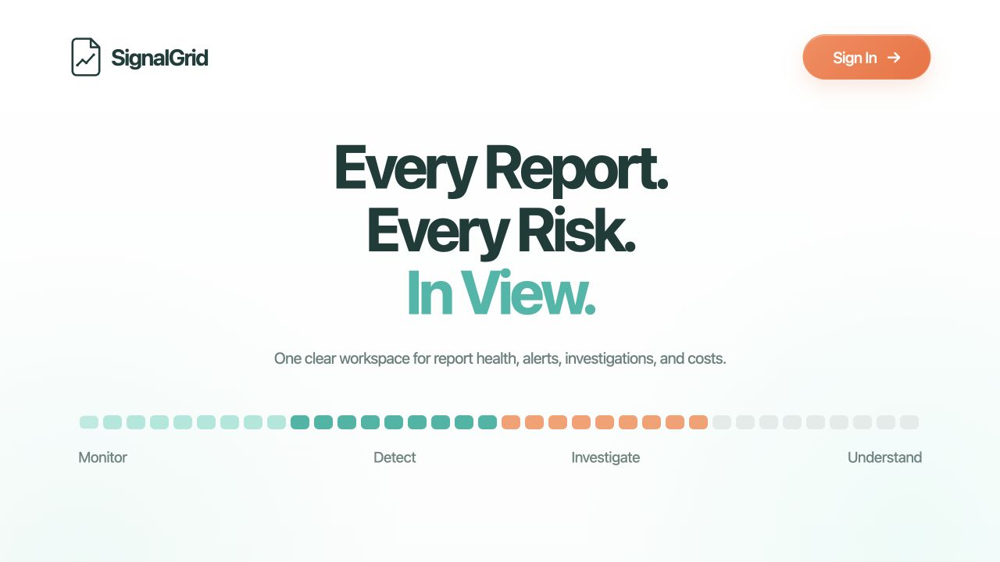
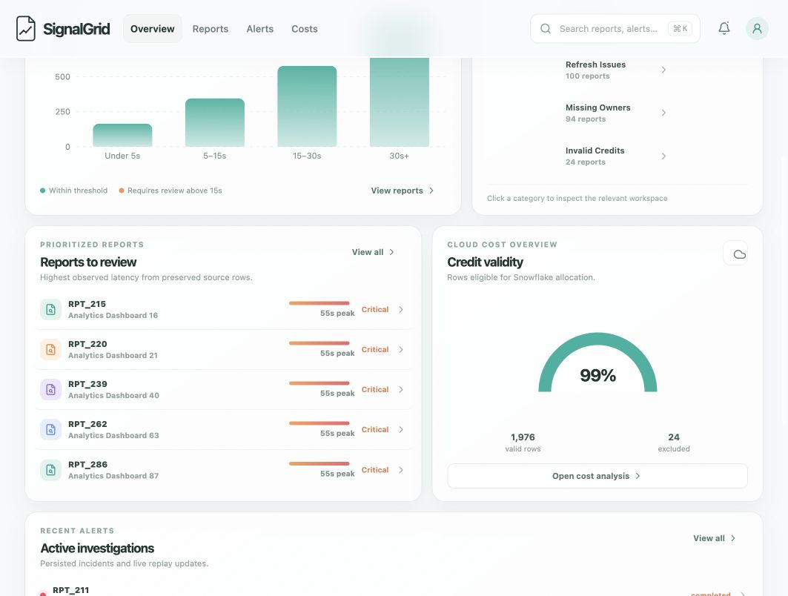
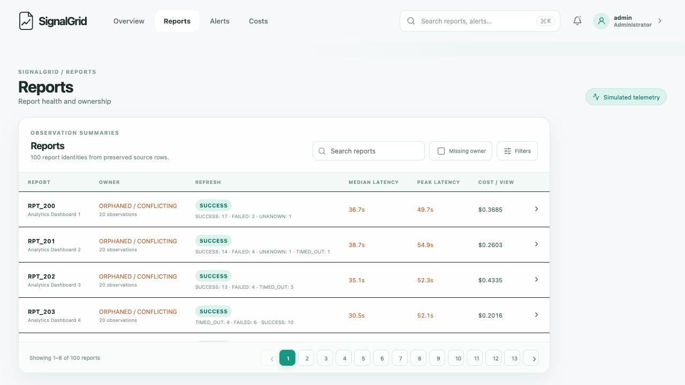
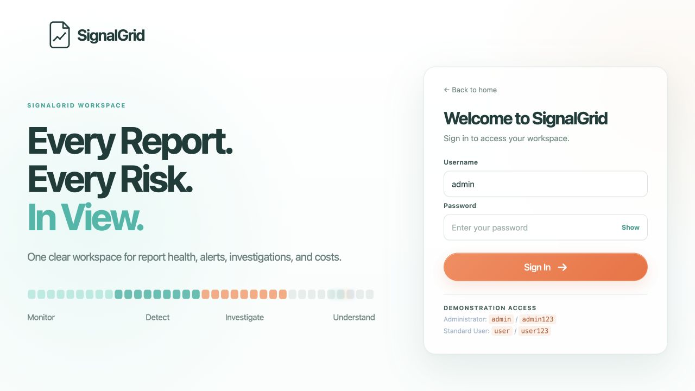
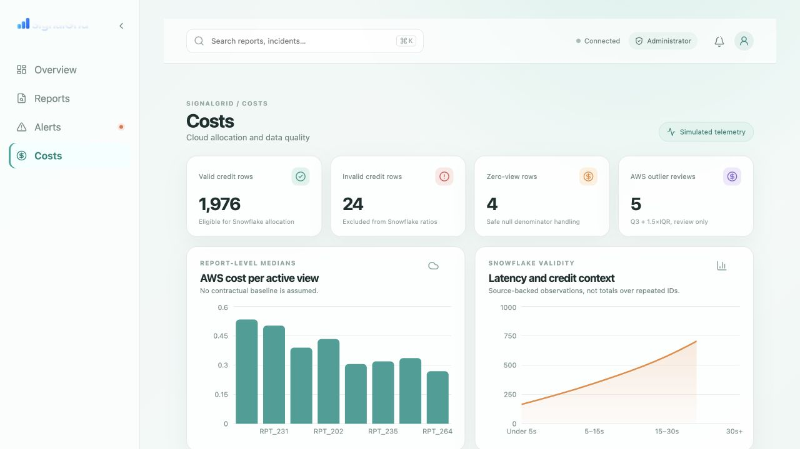

# SignalGrid

<p align="center">
  
</p>

<p align="center">
  <strong>Every report. Every risk. In view.</strong><br />
  A calm, source-backed workspace for report health, alerts, investigations, and cloud cost visibility.
</p>

<p align="center">
  <a href="#run-locally">Run locally</a> ·
  <a href="#demo-access">Demo access</a> ·
  <a href="#what-you-can-explore">Explore SignalGrid</a>
</p>

<p align="center">
  
</p>

## A focused operational view

SignalGrid turns a preserved monitoring dataset into a practical, explorable workspace. It keeps the important things close together: the report that needs attention, the observation that triggered it, the incident evidence behind it, and the financial context around it.

The experience is designed to be useful at a glance and trustworthy under inspection:

- a bright, restrained landing and sign-in experience;
- live replay with deterministic threshold and data-quality findings;
- role-aware workspaces for administrators, owners, and analysts;
- paginated reports and alerts with search and filters;
- evidence-first incident investigations with optional AI analysis;
- explainable Snowflake-credit and AWS-cost views;
- resilient sessions, SSE notifications, and a safe deterministic fallback.

<p align="center">
  
  
</p>

## Run locally

Requirements: Node.js 22 or newer.

```bash
git clone https://github.com/anvayarora/signalgrid.git
cd signalgrid
npm install
cp .env.public.example .env
npm run dev
```

Open **http://localhost:5173** on the same computer or device. To view it from another device on the same network, start the frontend bound to your local interface and open the displayed network URL:

```bash
npm run dev -w apps/web -- --host 0.0.0.0
```

The API runs on port `4000` and the Vite frontend on port `5173`. If those ports are busy, update `PORT` in your private `.env` and the proxy target in `apps/web/vite.config.ts` together.

For a production-style local run:

```bash
npm run build
npm start
```

The server serves the built frontend and API together at **http://localhost:4000**.

## Demo access

Demo authentication is enabled by `.env.public.example` for local use only:

| Account | Username | Password | Workspace |
| --- | --- | --- | --- |
| Administrator | `admin` | `admin123` | Full monitoring and replay controls |
| Owner | `user` | `user123` | Assigned reports, alerts, investigations, and costs |
| Analyst | `analyst` | `analyst123` | Assigned monitoring and report-level financial evidence |

The credentials are intentionally local-demo credentials. Use a private environment file with strong passwords for any shared or hosted environment. Never publish `.env.example`.

## What you can explore

### Overview

See the current report population, threshold breaches, refresh health, ownership quality, prioritized reports, recent alerts, and cost-quality signals in one quiet command centre.

### Reports and alerts

Search and filter the preserved records, move through compact pages, and open a single modal to inspect the exact source observations, ownership quality, thresholds, incident history, and cost-per-view context.

### Investigations

Open an alert from the notification bell or from its table row. The investigation keeps measured facts separate from policy-approved hypotheses, safe diagnostic checks, missing evidence, provider status, and fallback state. Optional NVIDIA analysis stays behind the authenticated API and never exposes a private key in the browser.

### Replay

Administrators can choose a curated demonstration or a complete 2,000-row replay. Owners and analysts receive isolated replay sessions derived from their actual assignments. Progress, detections, incident grouping, and notifications are persisted and scoped to the current session.

### Costs

Review valid and excluded rows, zero-view handling, Snowflake credits per view, AWS dollars per view, and the evidence behind each quality flag. Snowflake credits remain credits; AWS values remain USD.

<p align="center">
  
  
</p>

## Source and project map

```text
apps/api/                 Server-side application code
apps/web/                 Browser application and visual system
data/raw/monitoring.csv   Preserved 2,000-row source dataset
scripts/snowflake/        Schema, quality, attribution, validation, and reference SQL
docs/                     Product, usage, data-quality, and verification notes
```

## Verification

```bash
npm test
npm run build
```

The current regression suite covers authentication, role and session scoping, replay lifecycle, SSE recovery, deterministic detection, report ownership, cost aggregation, RCA tool-call ordering, strict controlled output validation, fallback behavior, and the two replay/incident authorization edge cases.

The hosted NVIDIA acceptance path is intentionally separate from the regular suite. It requires a private `NVIDIA_KEY`; without one, SignalGrid remains fully usable with deterministic evidence-backed investigations and clearly labeled fallback state.

## Data notes

The included CSV is a preserved demonstration dataset. It contains repeated observations without reliable event timestamps, so the interface does not present derived costs as a verified monthly bill or claim a live cloud-account connection. The Snowflake scripts document the supported attribution path and the limits of the available source data.

## License

This repository is provided as a demonstration project. Add the license and contribution policy appropriate for your intended distribution before publishing it as an open-source package.
